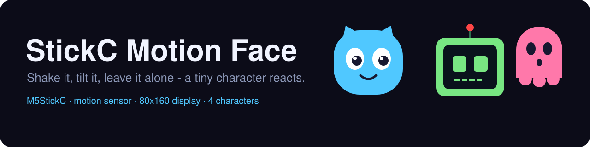

<p align="center">
  
</p>

<p align="center">
  <b>A tiny animated character for the M5StickC that reacts to how you move it.</b><br>
  Tilt &middot; move &middot; shake &middot; drop &middot; leave it alone &mdash; 4 characters, no Wi-Fi, no setup
</p>

<p align="center">
  <a href="https://electroiot.github.io/M5-StickC-Motion-Face/flasher/"><b>Install in your browser</b></a> &middot;
  <a href="docs/FLASHING.md">Flashing guide</a> &middot;
  <a href="#how-it-reacts">How it reacts</a> &middot;
  <a href="docs/M5BURNER.md">M5Burner</a>
</p>

<p align="center">
  
</p>

## Characters

All pictures are real screenshots taken from the device over USB (`tools/shot.py`).

| | Idle | Happy (moved) | Dizzy (shaken) | Scared (dropped) | Asleep |
|---|:---:|:---:|:---:|:---:|:---:|
| **Cat** |  |  |  |  |  |
| **Robo** |  |  |  |  |  |
| **Boo** |  |  |  |  |  |
| **Cyclo** |  |  |  |  |  |

## How it reacts

| You do | It does |
|---|---|
| Tilt it | the eyes follow the tilt (works however you hold it) |
| Leave it | blinks, glances around, occasionally double-blinks |
| Move it | happy `^ ^` eyes, open mouth, bounces |
| **Shake it** | **dizzy**: spiral eyes, wobble, orbiting stars |
| Drop it (free fall) | **scared**: huge eyes, shaking, sweat drop |
| Still for ~12 s | gets drowsy, eyelids droop |
| Still for ~25 s | **asleep**: eyes closed, breathing, floating Zzz |
| Press **A** (front) | **next character** with a pop animation |
| Hold **A** or press **B** (side) | new colour (6 themes) |

The area under the face shows the character name, the current mood and the battery level.
Your character and colour are remembered after power off.

## Install

- **Browser (easiest):** open the [web installer](https://electroiot.github.io/M5-StickC-Motion-Face/flasher/) in Chrome or Edge.
- **M5Burner:** search *StickC Motion Face* (device type STICKC).
- **esptool:** `esptool.py --chip esp32 --port COM18 write_flash 0x0 M5-StickC-Motion-Face-v1.0.0-full.bin` from the [Releases](../../releases) page.
- **PlatformIO:** `git clone`, then `pio run -t upload`.

Details: [docs/FLASHING.md](docs/FLASHING.md). A StickC with no firmware shows a blank screen.

## Hardware

| | |
|---|---|
| Board | [M5StickC](https://docs.m5stack.com/en/core/m5stickc) (ESP32-PICO-D4, 4 MB flash) - the original, **not** the Plus or Plus2 |
| Display | 0.96" 80x160 colour LCD (face drawn in a 128x128 canvas and scaled) |
| Motion sensor | the built-in IMU (accelerometer used) |
| Buttons | A (front), B (side) |

Libraries: [M5Unified](https://github.com/m5stack/M5Unified) (pulls in M5GFX). Nothing else.

## Tuning & test console

Sensitivity constants are at the top of [`src/main.cpp`](src/main.cpp) (`SHAKE_ENERGY`, `MOVE_ENERGY`,
`SLEEP_AFTER_MS`). A serial console (115200) can force any character or mood, and `tools/shot.py`
captures real screenshots. Problems? [docs/TROUBLESHOOTING.md](docs/TROUBLESHOOTING.md).

Also available for the AtomS3: [M5-AtomS3-Motion-Face](https://github.com/ElectroIoT/M5-AtomS3-Motion-Face).

## Repository

```
src/main.cpp        the whole firmware
platformio.ini      build config (m5stick-c)
tools/shot.py       screenshots / gallery / GIF over USB
docs/               guides, images, screenshots, web installer (docs/flasher)
```

## License

MIT - see [LICENSE](LICENSE).
